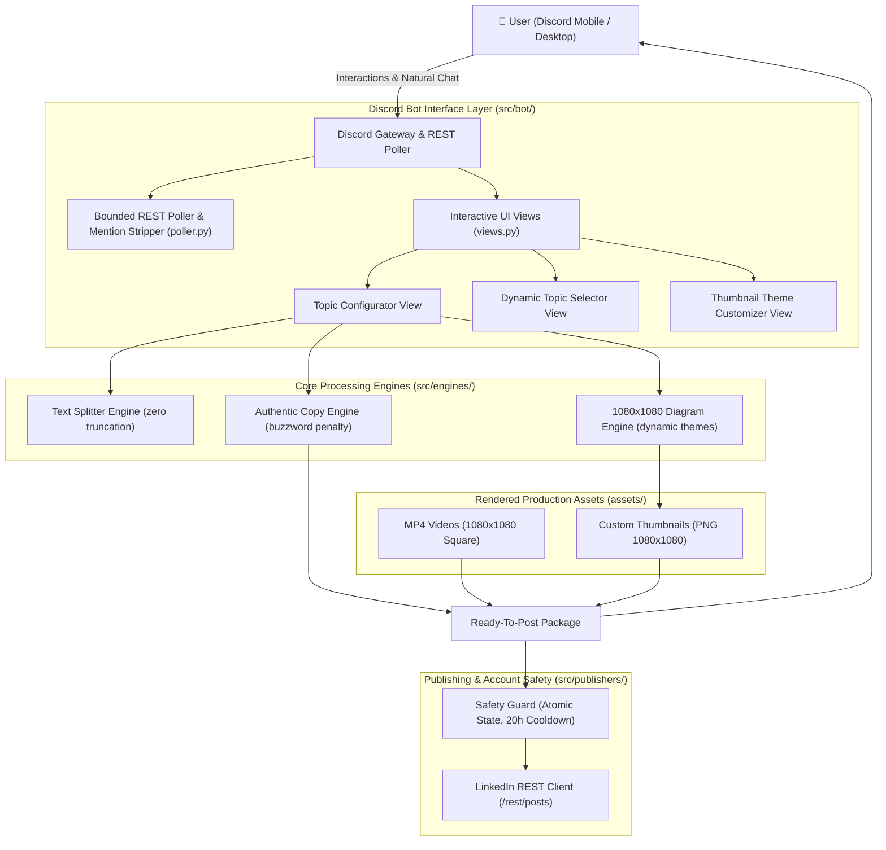

# LinkedIn Automation Studio — Architecture Blueprint

## 1. System Overview
**LinkedIn Automation Studio** is an autonomous, high-retention content creation and distribution engine. It generates authentic developer-first LinkedIn technical breakdown posts, animated 1080x1080 motion graphics (via Manim), crisp dynamic architecture cards (via PIL), and provides an interactive mobile-first Discord command studio with instant delivery (< 2s) and strict account safety guardrails.

---

## 2. Component Architecture



---

## 3. Directory Layout

```
D:\LinkedInAutomationStudio\
├── .env                          # API credentials & configuration
├── main.py                       # Root application entry point
├── assets/
│   ├── thumbnails/               # High-res 1080x1080 PNG cover images
│   └── videos/                   # Pre-compiled 1080x1080 MP4 motion graphics
├── data/
│   └── publish_state.json        # Atomic persistence for cooldown tracking
├── docs/
│   ├── ARCHITECTURE.md           # System design & architecture blueprint
│   └── OPERATIONS.md             # Runbook, troubleshooting, and commands
├── src/
│   ├── animations/               # Manim CE v0.22.0 animation scene definitions
│   │   ├── oauth.py
│   │   ├── queue.py
│   │   ├── rate_limiter.py
│   │   ├── sql_index.py
│   │   ├── idempotency.py
│   │   └── cache_aside.py
│   ├── bot/                      # Discord bot studio
│   │   ├── client.py             # Bot lifecycle & gateway auto-reconnect
│   │   ├── poller.py             # Bounded-memory LRU poller & regex intent parser
│   │   └── views.py              # Mobile dropdowns & interactive UI views
│   ├── config/                   # Settings & topic definitions
│   │   ├── settings.py           # Environment settings & path constants
│   │   └── topics.py             # 12-topic pool with dataclass models
│   ├── engines/                  # Independent, testable core engines
│   │   ├── copy_engine.py        # Post copy builder & anti-AI buzzword scorer
│   │   ├── diagram_engine.py     # 1080x1080 dark-mode card generator
│   │   └── text_splitter.py      # Natural word-boundary wrapping for Discord
│   └── publishers/               # Safe LinkedIn API distribution
│       ├── linkedin_client.py    # Official LinkedIn REST API client
│       └── safety_guard.py       # Atomic file lock & 20h cooldown guard
└── tests/                        # Adversarial unit & integration test suite
    ├── test_copy_engine_adversarial.py
    ├── test_diagram_engine_adversarial.py
    ├── test_integration_adversarial.py
    ├── test_poller_adversarial.py
    ├── test_safety_guard_adversarial.py
    └── test_text_splitter_adversarial.py
```

---

## 4. Key Design Decisions

1. **Bounded LRU Memory Deduplication:**
   - Previous unbounded `set()` memory leak replaced with `BoundedMessageTracker` (capped at 1,000 items with O(1) membership check), preventing memory exhaustion in 24/7 daemon runs.
2. **Atomic State Persistence:**
   - State writing uses `tempfile` and `os.replace` to prevent zero-byte file corruptions on unexpected system crashes.
3. **Word-Boundary Intent Parsing:**
   - Strict regex word boundaries (`\b(start|menu|topics?)\b`) eliminate substring collisions (e.g. `'hi'` inside `'this'` or `'something'`).
4. **Zero-Truncation Mobile Dropdowns:**
   - Pure algorithm splits strings across label (38 chars) and description (95 chars) at natural spaces, ensuring the entire question is visible on iOS/Android Discord without cutting words in half.
5. **Instant Delivery Model:**
   - Pre-rendered 1080x1080 MP4 videos and PNG thumbnails deliver packages in under 2 seconds. No waiting for 30-minute re-renders.
