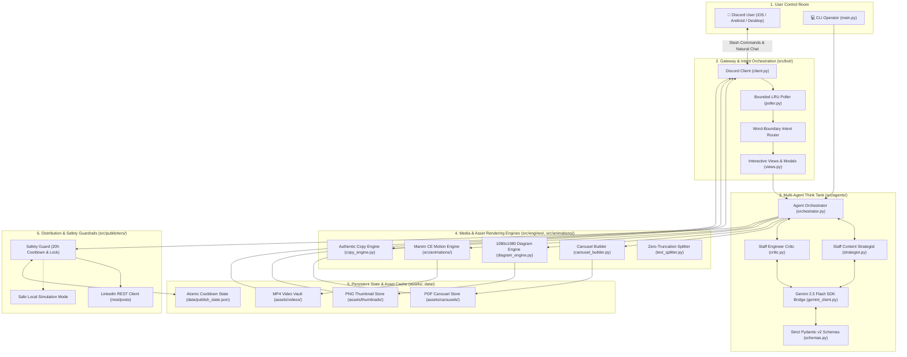

# 🏛️ LinkedIn Automation Studio — Technical Architecture Blueprint

## 1. Executive Summary

**LinkedIn Automation Studio** is an autonomous, multi-agent media production engine. It transforms raw technical concepts and architectural patterns into production-grade, high-retention LinkedIn assets:
1. **Vertical Multi-Slide PDF Carousels** (1080x1350, 4:5 mobile ratio, vector graphics, high readability).
2. **Kinetic Motion Graphics** (1080x1080 square MP4 videos rendered with Manim Community Edition).
3. **High-Resolution Architecture Diagrams** (1080x1080 PNG cards rendered via Pillow with multi-theme support).
4. **Authentic Technical Post Copy** (Zero buzzwords, battle-tested engineering framing, calibrated engagement loops).

The system is controlled via an interactive, mobile-optimized Discord studio bot delivering sub-2-second preview packages, backed by atomic rate-limiting and a multi-agent self-refinement pipeline.

---

## 2. High-Level System Topology



---

## 3. Core Component Subsystems

### 3.1 Gateway & Bot Dispatcher (`src/bot/`)
- **`client.py`**: Initializes the Discord bot client with privileged `message_content` intents, manages lifecycle events (`on_ready`, `on_message`), and handles graceful auto-reconnects.
- **`poller.py`**: Employs a bounded LRU ring buffer (`BoundedMessageTracker`, default 1,000 IDs) to ensure zero memory leaks during 24/7 daemon execution. Uses word-boundary regular expressions (`\b(start|menu|topics?)\b`) to prevent false-positive intent firing.
- **`views.py`**: Rich interactive Discord UI components (Select dropdowns, action buttons). Features natural word-boundary splitting across select option labels (38 chars max) and descriptions (95 chars max) to guarantee zero UI clipping on mobile devices.

### 3.2 Multi-Agent Cognitive Pipeline (`src/agents/`)
- **`orchestrator.py`**: Coordinates the generation lifecycle between the Strategist and Critic. If the Critic's quality score falls below 80/100, the orchestrator triggers an automated refinement loop (up to 2 iterations), feeding targeted feedback back to the Strategist.
- **`strategist.py`**: Senior Content Strategist persona powered by Google Gemini 2.5 Flash. Generates structured JSON schemas containing slide-by-slide breakdowns, hook variants, key takeaways, and visual layout specs.
- **`critic.py`**: Staff Engineer Critic persona. Adversarially evaluates the generated outline for technical depth, fluff penalty, visual pacing, and audience retention. Rejects superficial listicles and forces concrete real-world tradeoffs.
- **`schemas.py`**: Robust Pydantic v2 data models (`CarouselPlan`, `SlidePlan`, `CriticEvaluation`, `CopyPlan`) enforcing strict type contracts, min/max length constraints, and schema validation.
- **`gemini_client.py`**: Resilient client utilizing the new `google-genai` SDK with retry backoff, response sanitization, and fallback topic handling.

### 3.3 Media Rendering Engines (`src/engines/` & `src/animations/`)
- **`carousel_builder.py`**: Pure Python Pillow-based PDF generator. Renders high-resolution 1080x1350 multi-page slide decks. Incorporates vector shape rendering (accents, cards, borders, badges) instead of emojis to eliminate font tofu glyph corruption (`[]`).
- **`diagram_engine.py`**: Renders 1080x1080 architecture breakdown cards. Supports 5 dark-mode palette themes (Slate, Navy, Obsidian, Cyberpunk, Emerald).
- **`text_splitter.py`**: Pure word-boundary string wrapping algorithm. Safely splits strings into chunks without ever cutting words in half or exceeding API payload limits.
- **`copy_engine.py`**: Post copy synthesis engine with anti-AI buzzword penalty scoring (penalizes *"In today's fast-paced world"*, *"Delve"*, *"Game-changer"*).
- **`src/animations/`**: Manim Community Edition (CE v0.22.0) programmatic scenes. Enforces strict coordinate boundaries ($Y \ge -1.8$) to guarantee zero visual collisions with the bottom video player HUD/scrubber.

### 3.4 Publishing & Account Safety (`src/publishers/`)
- **`safety_guard.py`**: Hard-coded safety boundary enforcing a mandatory 20-hour cooldown between automated LinkedIn posts. Uses atomic temporary-file writes (`tempfile.NamedTemporaryFile` + `os.replace`) to prevent state corruption during sudden process halts.
- **`linkedin_client.py`**: Official LinkedIn REST API integration (`/rest/posts`, `/rest/images`, `/rest/videos`). Falls back automatically to Safe Simulation Mode if credentials are not provided or invalid.

---

## 4. End-to-End Pipeline Data Flow

```mermaid
sequenceDiagram
    autonumber
    actor User as User (Discord)
    participant Poller as Bounded Poller
    participant Orchestrator as Agent Orchestrator
    participant Strategist as Gemini Strategist
    participant Critic as Gemini Critic
    participant Builder as Carousel / Media Engine
    participant Guard as Safety Guard
    participant LinkedIn as LinkedIn API

    User->>Poller: "create a carousel for Kafka architecture"
    Poller->>Orchestrator: Dispatch request (topic="Kafka Architecture", mode="carousel")
    
    rect rgb(20, 30, 45)
        note over Orchestrator,Critic: Multi-Agent Think Tank Loop
        Orchestrator->>Strategist: Request Carousel Strategy & Slides
        Strategist-->>Orchestrator: Return CarouselPlan (Pydantic validated)
        Orchestrator->>Critic: Evaluate CarouselPlan
        Critic-->>Orchestrator: CriticEvaluation (Score: 74/100, Fluff detected)
        Orchestrator->>Strategist: Refine with Critic Feedback
        Strategist-->>Orchestrator: Refined CarouselPlan (Score: 92/100)
    end

    Orchestrator->>Builder: Render 1080x1350 Slide Deck
    Builder-->>Orchestrator: Generated PDF artifact (/assets/carousels/kafka.pdf)
    
    Orchestrator->>User: Deliver Discord Embed with PDF attachment & post copy
    
    alt User clicks "🚀 Confirm & Publish"
        User->>Guard: Trigger publish request
        Guard->>Guard: Check 20h cooldown & acquire atomic lock
        Guard->>LinkedIn: Upload document & create post
        LinkedIn-->>Guard: HTTP 201 Created (Post URN)
        Guard->>Guard: Update publish_state.json atomically
        Guard-->>User: Post published successfully!
    else Simulation Mode
        Guard-->>User: Simulated publication logged (zero API calls)
    end
```



---

## 5. Security & Isolation Architecture

1. **Zero Hardcoded Secrets:**
   - No tokens, client IDs, or webhook URLs exist anywhere in the git history or codebase.
   - All sensitive credentials are read strictly from OS environment variables (`.env`).
   - `.gitignore` and CI/CD secret scanners continuously enforce this boundary.

2. **Atomic Persistence:**
   - All state modifications (cooldown timestamps, publishing logs) write first to an isolated temporary file on the same filesystem volume, then execute an atomic rename (`os.replace`). This guarantees zero file truncation or corrupted JSON even during sudden system power failure.

3. **Subprocess & Execution Security:**
   - Manim rendering executes via strict parameterized argument lists (`subprocess.run(["manim", ...])`), completely bypassing shell invocation (`shell=False`) to eliminate shell injection vulnerabilities (Bandit B602/B603 compliant).

4. **Input Sanitization & Safe Deserialization:**
   - All external JSON payloads pass through Pydantic v2 validation models. No untrusted pickle deserialization is permitted anywhere in the architecture.

---

## 6. Directory File Structure

```
D:\LinkedInAutomationStudio\
├── .env.example                  # Sanitized environment variable template
├── .gitignore                    # Git ignore rules for media, venv, and keys
├── .coderabbit.yaml              # CodeRabbit AI PR review rules & boundaries
├── LICENSE                       # MIT License (ahmed-husssain 2026)
├── CONTRIBUTING.md               # Contributor workflow and PR guidelines
├── README.md                     # Project overview and entry index
├── main.py                       # Application CLI & bot launcher
├── assets/                       # Output media directories
│   ├── carousels/                # Multi-page PDF carousels (1080x1350)
│   ├── thumbnails/               # High-res PNG architecture cards (1080x1080)
│   └── videos/                   # Pre-compiled MP4 animations (1080x1080)
├── data/                         # Persistent application state
│   └── publish_state.json        # Atomic state file for publish cooldowns
├── docs/                         # Master documentation & agent context harness
│   ├── architecture.md           # System topology & pipeline blueprint (this file)
│   ├── prd.md                    # Product requirements & acceptance criteria
│   ├── roadmap.md                # 4-phase strategic evolution roadmap
│   ├── agents.md                 # Multi-agent roster & interaction contracts
│   ├── design_system.md          # Visual specs, canvas bounds, & safe zones
│   ├── rules.md                  # Non-negotiable system invariants
│   ├── skills.md                 # Operational guide for Ponytail skills
│   ├── memory.md                 # Living incident log & architectural memory
│   ├── setup_guide.md            # Comprehensive beginner setup guide
│   └── OPERATIONS.md             # Operational runbook & troubleshooting
├── src/                          # Application source code
│   ├── agents/                   # Multi-agent orchestration & schemas
│   ├── animations/               # Manim CE v0.22.0 scene definitions
│   ├── bot/                      # Discord bot gateway, poller, & views
│   ├── config/                   # Settings & curated topic pools
│   ├── design_system/            # Python visual tokens & layout rules
│   ├── engines/                  # Pillow rendering & copy synthesis
│   └── publishers/               # Safe LinkedIn API distribution
└── tests/                        # Adversarial unit & integration test suite
```
