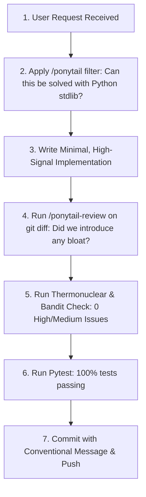

# 🛠️ Senior Engineering Skills & Operational Playbook

## 1. Overview & Purpose

This document is the **Operational Playbook** defining how autonomous AI agents (Antigravity, Claude, Gemini) and human contributors utilize specialized engineering skills within **LinkedIn Automation Studio**.

By incorporating these skills into your workflow, you ensure that every line of code committed is:
* **Radically Minimal:** Zero speculative bloat, zero unnecessary dependencies.
* **Standard-Library First:** Prefers native Python primitives over heavy third-party frameworks.
* **Adversarially Hardened:** Free of security vulnerabilities, race conditions, memory leaks, and visual collisions.

---

## 2. The Ponytail Suite (Senior Minimalist Engineering)

The **Ponytail** suite channels the wisdom of a pragmatic senior staff engineer who has seen hundreds of codebases collapse under unnecessary abstraction. It rejects premature optimization, speculative factories, and cargo-cult architecture.

### 2.1 `/ponytail` — Minimalist Coding Mode
* **Trigger:** Say `/ponytail`, `"be lazy"`, `"simplest solution"`, `"YAGNI"`, or `"minimal solution"`.
* **Philosophy:**
  1. Question whether the requested code needs to exist at all.
  2. Reach for the Python standard library (`collections`, `dataclasses`, `pathlib`, `json`, `subprocess`) before adding an external package.
  3. Write 1 line of clear code before 50 lines of framework boilerplate.
* **Intensity Levels:**
  - `lite`: Pragmatic shortcuts, standard library preference, gentle cleanup.
  - `full` *(Default)*: Aggressively cuts unnecessary abstractions, rejects new dependencies unless impossible to avoid, replaces custom utilities with stdlib.
  - `ultra`: Extreme minimalism. Inline implementations, absolute zero-dependency additions, bare-metal Python.

### 2.2 `/ponytail-review` — Anti-Bloat Code Review
* **Trigger:** Say `/ponytail-review`, `"review for over-engineering"`, or `"what can we delete"`.
* **Execution:**
  - Evaluates git diffs specifically for **over-engineering** (not just syntax).
  - Hunts for:
    - Reinvented standard library utilities (e.g. custom string formatters when `str.format()` or f-strings suffice).
    - Unused parameters, speculative generic types (`T`), and dead interfaces.
    - Added packages that could be done in 5 lines of vanilla Python.
  - **Output Format:** Exactly one line per finding:
    `[file:line] -> [What to delete] -> [What stdlib/native replaces it]`

### 2.3 `/ponytail-audit` — Whole-Repository Complexity Audit
* **Trigger:** Say `/ponytail-audit`, `"audit this codebase"`, or `"find bloat"`.
* **Execution:**
  - Scans the entire repository tree for architectural bloat, dead modules, duplicate utilities, and unused imports.
  - Generates a ranked list of recommended deletions sorted by impact.

### 2.4 `/ponytail-debt` — Deliberate Shortcut Ledger
* **Trigger:** Say `/ponytail-debt`, `"list the shortcuts"`, or `"what did we mark to do later"`.
* **Execution:**
  - Harvests every `# ponytail: <note>` comment across the codebase into an organized debt ledger.
  - Ensures deliberate pragmatic shortcuts taken for speed are tracked and never become forgotten tech debt.

### 2.5 `/ponytail-gain` — Impact Scoreboard
* **Trigger:** Say `/ponytail-gain` or `"show ponytail impact"`.
* **Execution:**
  - Calculates net lines of code removed, dependencies avoided, and execution speed gained.

---

## 3. Thermonuclear Code Review Skill

* **Trigger:** Say `/thermonuclear-code-review-skill`, `"thermonuclear review"`, or `"adversarial review"`.
* **Philosophy:** An exhaustive, zero-mercy security and resilience audit designed to catch the hardest class of distributed bugs before production deployment.

### 3.1 Five Inspection Pillars

```
+------------------------------------------------------------------------+
|                  THERMONUCLEAR ADVERSARIAL PILLARS                     |
+-------------------+--------------------+-------------------------------+
| 1. Security &     | Bandit B-rules     | Zero secrets in git history   |
|    Sanitization   | Subprocess args    | Input length & type contracts |
+-------------------+--------------------+-------------------------------+
| 2. Concurrency &  | Atomic temp writes | Non-blocking asyncio event    |
|    Race Safety    | File lock barriers | Subprocess timeout bounds     |
+-------------------+--------------------+-------------------------------+
| 3. Memory & State | Bounded LRU caches | Zero unbounded growing sets   |
|    Bounds         | Leaked descriptors | Garbage collection profiles   |
+-------------------+--------------------+-------------------------------+
| 4. Spatial Safe   | Manim Y >= -1.8    | Carousel 120px header/footer  |
|    Zones          | Zero font tofu     | Zero text clipping on mobile  |
+-------------------+--------------------+-------------------------------+
| 5. Deterministic  | Pytest coverage    | Offline fallback guarantees   |
|    Verification   | Mock isolation     | 100% reproducible builds      |
+-------------------+--------------------+-------------------------------+
```

1. **Security & Secrets Guard:**
   - Verifies zero hardcoded tokens or API keys exist.
   - Enforces parameterized argument lists in `subprocess.run(shell=False)` to prevent shell injection.
   - Enforces `bandit -r src/ -ll -ii` compliance with 0 High issues.
2. **Atomic Concurrency & Persistence:**
   - Ensures no file writes use destructive direct overwrites (`open('w')`). Enforces `tempfile` + `os.replace`.
   - Ensures async bot event handlers never execute blocking CPU-heavy tasks on the main event loop (offloads to `asyncio.to_thread`).
3. **Bounded Memory Invariants:**
   - Verifies all pollers and trackers enforce explicit maximum capacities (`BoundedMessageTracker(max_size=1000)`).
4. **Visual Spatial Verification:**
   - Confirms Manim coordinates obey $Y \ge -1.8$.
   - Confirms PIL typography eliminates Unicode emojis that cause rectangular tofu glyphs.
5. **Adversarial Test Coverage:**
   - Confirms negative and boundary cases are covered by tests in [`tests/`](file:///D:/LinkedInAutomationStudio/tests/).

---

## 4. How Autonomous AI Agents Must Apply These Skills

When an AI agent is working on this codebase, it must follow this mandatory lifecycle:



1. **Before Writing Code:** Ask whether standard library modules can achieve the requirement. Reject adding new packages to `requirements.txt` unless strictly necessary.
2. **During Implementation:** Keep functions small, types explicit (Pydantic v2), and paths cross-platform (`pathlib.Path`).
3. **Before Submitting / Committing:**
   - Execute `pytest tests/` to verify zero regression.
   - Run Bandit security check: `bandit -r src/ -ll -ii --exclude src/animations/`.
   - Verify all spatial rules ($Y \ge -1.8$ HUD bound and 120px carousel safe zones) are respected.
